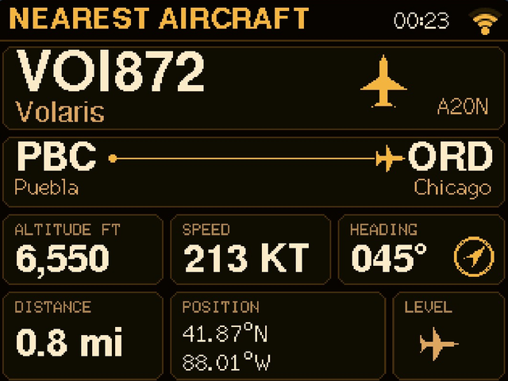
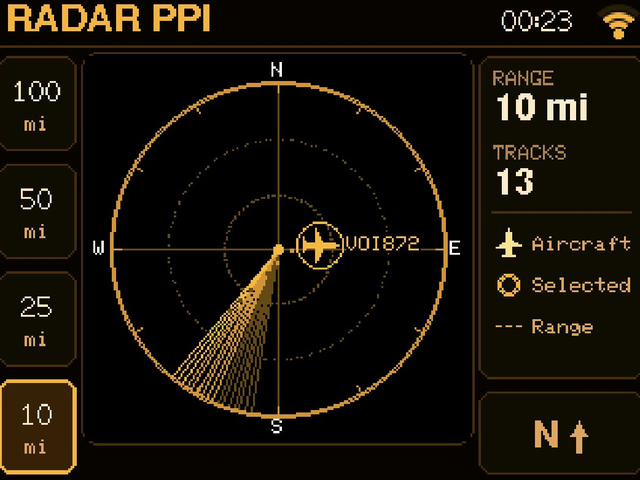
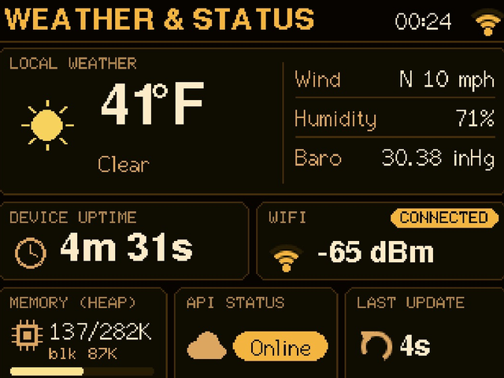
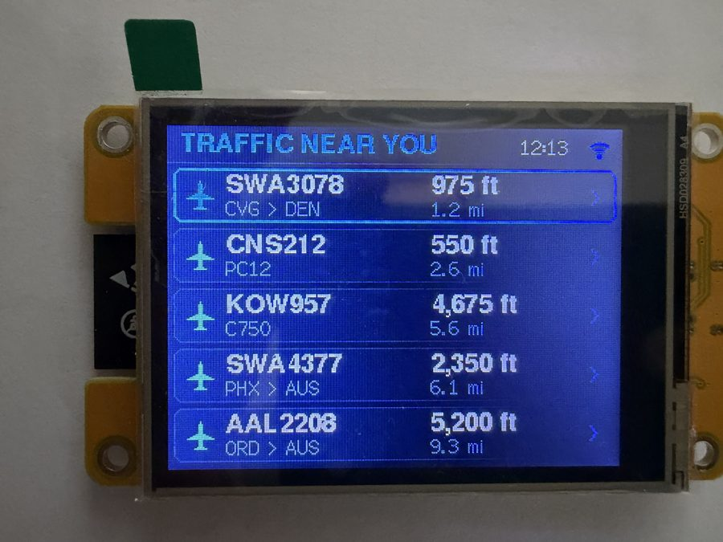

# CYD28 Plane Spotter ✈️

A real-time aircraft tracker for the **ESP32 Cheap Yellow Display (CYD)** that renders a live radar PPI (Plan Position Indicator), shows nearby aircraft details, and provides weather & system status — all on a 2.8" 240×320 TFT touchscreen.

| Nearest aircraft | Radar |
|:---:|:---:|
|  |  |
| **Weather & status** | **On the device** |
|  |  |

*Screenshots taken with the web page's screen mirror (Amber theme); the photo shows the Navy theme on an ESP32-2432S028R with the HSD028309 panel (`cyd-alt` build).*

## Features

- **Nearest aircraft** — a flight card for the nearest (or a tapped) aircraft: callsign and flight number, airline, aircraft model and registration, route with city names and a progress bar, altitude, speed, distance/bearing and climb/descent rate.
- **Traffic** — the 5 closest flights with route, altitude and distance; tap a row to open its flight card.
- **Radar PPI** — rotating sweep with blips for the 20 nearest aircraft (callsign, altitude, speed) and range presets on the left.
- **Weather & System** — temperature, conditions, humidity, wind and pressure from Open-Meteo, plus WiFi signal, memory, active data source and request counters.
- **Settings menu** — WiFi setup, locate by IP, touch calibration, screen brightness, LED alerts on/off and arrow navigation, opened by tapping the clock / WiFi icon.
- **WiFi setup portal** — no credentials in code needed: on first boot (or when the saved network is unreachable) the device opens a `PlaneSpotter-Setup` hotspot and shows a QR code: scan it with the phone camera to join, then pick your network and enter your city on the page that opens.
- **Updates over WiFi** — one-click install of the latest GitHub release from the web page, or upload a file from the browser (`http://planespotter.local`) or from PlatformIO; no USB cable needed after the first flash.
- **Web Configuration** — built-in web server with a city search, plus home location, search radius, radar range and a "Forget WiFi" button, from any browser on the same network.
- **Dual-core architecture** — all HTTP/API calls (aircraft, routes, weather) run on Core 0 in a FreeRTOS task; UI rendering and touch handling run on Core 1, keeping the display smooth.
- **Back RGB LED alerts** — the LED on the back of the board can glow green/yellow/red by distance to the nearest aircraft, and/or blink when a special aircraft comes within the alert range: helicopters (blue), military (magenta), government/rare aircraft (orange), low-flying aircraft (cyan), or anything on your own watch list of type codes and callsign prefixes (white). Each aircraft blinks once, then the LED glows steadily while it stays in range.
- **Phone notifications** — push notifications through [ntfy](https://ntfy.sh) (free, no account): install the ntfy app, subscribe to a random topic and enter it on the web page. You choose the range and the kinds of aircraft (watch list, military, government/rare, helicopters, low flying). Each aircraft is sent once per cooldown period, and notifications can stay quiet during night mode. Tapping a notification opens the aircraft on the airplanes.live map.
- **Emergency squawks** — an aircraft squawking 7700 (emergency), 7600 (radio failure) or 7500 (hijack) anywhere in the search area gets a blinking red banner on every screen, a fast red blink of the back LED, an urgent phone notification and a line in today's log.
- **Type collection** — every aircraft type seen is saved (type code, model, first callsign and registration, date) in the internal flash. The web page lists it with links to read about the type, photos of that airframe and its track on the map; new types show a banner and, after the collection's first day, a phone notification. Downloadable as CSV.
- **Helicopter symbols** — rotorcraft (ADS-B category A7) are drawn as a helicopter instead of an airplane on the radar, in the traffic list and on the flight card.
- **Radar trails and tap-to-select** — each aircraft on the radar leaves a short trail of its last positions; tap an aircraft on the radar (or a row on the Traffic page) to open its flight card.
- **Clock and METAR screens** — a clock (digital, digital with seconds, or analog; 12/24-hour) with weather and today's count, and a METAR screen with wind, visibility, ceiling, temperature, altimeter, flight category and the raw report for a chosen airport or the nearest one. Each can be off, a normal page, or shown only when no aircraft are nearby. The clock has its own card on the web page with a 12/24-hour switch, and can take over the screen at night: while night mode has the screen dimmed, only the clock is shown (a tap brings the normal pages back for 30 seconds).
- **Automatic page flipping** — optional, with an adjustable interval; pauses for a minute after a touch.
- **Color themes** — Navy, Midnight, Radar Green, Amber and Night Red. Switch from the device (*Settings*, the button with two colored dots) or the web page; Night Red can take over automatically during night mode.
- **Screen mirror** (optional, off by default) — the web page shows what is on the device screen, refreshed every few seconds, and a click on the picture taps the screen at that spot, so you can flip pages or open settings from your phone or computer.
- **Night mode** — dims the screen (or turns it off) on a schedule or from sunset to sunrise, optionally with the back LED off; a tap wakes the screen for 30 seconds.
- **Today's log** — the web page shows how many aircraft passed today, a per-hour chart, the lowest, fastest and closest aircraft, and notable sightings (watch list, military, government/rare, helicopters). It starts over at midnight and after a restart.
- **Safe updates** — *Switch back to <previous version>* on the web page restarts into the firmware that ran before the last update (it stays in the second flash slot). If new firmware crashes three times in a row right after boot, the device goes back to the previous version by itself.
- **Imperial or metric units** — miles/°F/mph by default, switchable to km/°C/km/h.

## Hardware

CYD boards ship with different display controllers, so there are three builds. The USB ports are only a hint; the firmware logs the panel ID at boot (`0xD3: xx 93 41` = ILI9341, `0x04: 85 85 52` = ST7789), and at power-on the screen flashes red/green/blue if the build matches.

| Board | Panel | PlatformIO env |
|-------|-------|----------------|
| ESP32-2432S028R, one micro-USB | ILI9341 | `cyd` (default) |
| ESP32-2432S028R, micro-USB + USB-C, panel label HSD028309 | ILI9341 | `cyd-alt` |
| ESP32-2432S028R "CYD2USB", micro-USB + USB-C | ST7789 | `cyd2usb` |

If the screen stays white or black after flashing, try the next build. If colors look inverted, add `-D DISPLAY_INVERT=1` to that environment's `build_flags`.

- **Touch**: XPT2046 resistive touch controller
- **RGB LED** (back side): red GPIO4, green GPIO16, blue GPIO17, active LOW
- **Display**: 240×320 pixels, rotation 1 (landscape)

## Data Sources

No API keys or accounts required.

| Source | Purpose |
|--------|---------|
| [airplanes.live](https://airplanes.live/), with [adsb.lol](https://adsb.lol/) and [adsb.fi](https://adsb.fi/) as fallbacks | Real-time ADS-B aircraft around your location (position, altitude, speed, type, registration) |
| [adsbdb.com](https://www.adsbdb.com/) | Callsign → airline and route; ICAO address → aircraft model |
| [Open-Meteo](https://open-meteo.com/) | Weather (temperature, conditions, humidity, wind, pressure) and city search (geocoding) |
| [ip-api.com](https://ip-api.com/) | Approximate location from IP ("Locate by IP" button) |

airplanes.live is free for non-commercial use and allows about one request per second; the default 10-second poll is well within that.

## Project Structure

```
CYD28PlaneSpotter/
├── platformio.ini          # PlatformIO build configuration (envs: cyd, cyd-alt, cyd2usb)
├── config.env.example      # Configuration template (copy to src/config.env)
├── .github/workflows/
│   ├── build.yml           # CI build for every push and pull request
│   └── release.yml         # builds and publishes a release for v* tags
├── lib/cydqr/              # QR code generator (setup portal QR)
└── src/
    ├── main.cpp            # Main application code
    └── config.env          # Your private config (gitignored)
```

## Setup

1. **Clone & open** in VS Code with the PlatformIO extension.
2. *(Optional)* **Copy the config template** — only needed to hard-code WiFi or change units/timezone:
   ```
   cp config.env.example src/config.env
   ```
3. *(Optional)* **Edit `src/config.env`** with your WiFi credentials, location and preferences:
   ```c
   #define WIFI_SSID "YourWiFi"
   #define WIFI_PASS "YourPassword"
   #define UNITS_IMPERIAL 1                       // 0 for km / °C
   #define TIMEZONE "CST6CDT,M3.2.0,M11.1.0"      // POSIX TZ string
   #define DEFAULT_HOME_LAT  41.8800              // your latitude
   #define DEFAULT_HOME_LON -88.0078              // your longitude
   ```
4. **Build & upload** for your board variant:
   ```
   pio run -e cyd -t upload        # see the table above for which env
   pio run -e cyd-alt -t upload
   pio run -e cyd2usb -t upload
   ```
5. **WiFi setup** (if no credentials in `config.env`): the screen shows instructions and a QR code. Scan it with your phone camera to join the `PlaneSpotter-Setup` network (or join it manually); the setup page opens by itself (or browse to `http://192.168.4.1`). Tap *Configure WiFi*, choose your network, enter the password and optionally your city (or `lat,lon`), and save. If nothing happens for 5 minutes the device restarts and tries again.
6. Once connected, the web address is shown on the Settings screen; open it in a browser to change settings live.

### Flashing a prebuilt image (no PlatformIO)

Download the files for your board from the latest [release](../../releases/latest): `<env>-merged.bin` for a first flash over USB, `<env>-firmware.bin` for updates over WiFi. (Every pull request and push to `master` is also built by GitHub Actions; the `firmware-<env>` artifact of a run has the same images.) Flash `<env>-merged.bin` at offset **0x0** with [ESP Tool](https://espressif.github.io/esptool-js/) in Chrome or Edge: *Connect*, pick the board's serial port, set *Flash Address* to `0x0`, choose the file, *Program*. WiFi and location are then set up through the setup portal. Flashing at `0x0` erases saved settings; to keep them when updating over USB, flash `<env>-firmware.bin` at `0x10000` instead.

### Updating over WiFi

After the first USB flash, updates don't need a cable:

- **From GitHub, one click:** open `http://planespotter.local`; the **Firmware** card shows the latest release. Press *Install vX.Y.Z from GitHub* and the device downloads `<env>-firmware.bin` for its board from that release and installs it. Settings are kept. The device checks for a new release at boot and twice a day, or when you press *Check for updates*. The same is available on the device: *Settings → Update*.
- **Browser:** open `http://planespotter.local` (or the IP shown on the Settings screen), scroll to **Firmware**, choose `<env>-firmware.bin` (or `<env>-merged.bin`) from the release for your board, and press *Update firmware*. The screen shows progress and the device restarts; settings are kept. The page shows the running version (commit hash) and build env.
- **PlatformIO:** `pio run -e cyd-alt -t upload --upload-port <device IP>` (ArduinoOTA on port 3232). Define `OTA_PASSWORD` in `config.env` to require a password for this route.

## Usage

- **Tap the screen** to cycle through the 4 main screens (Nearest aircraft, Traffic, Radar, Weather & status). Tapping the **top-right corner** (clock / WiFi icon) opens the settings menu.
- **Traffic page:** tap a row to show that aircraft on the first page for two minutes; tap the header to move on.
- **Radar page:** the buttons on the left switch between range presets (100/50/25/10 mi, or 200/100/50/25 km).
- **Settings menu**: *WiFi setup* (tap twice to confirm) reopens the setup portal; *Locate by IP* sets an approximate location; *Calibrate touch* runs a 3-point touch calibration with a test screen; *Brightness* cycles 100/60/30/10 %; *LED alerts* toggles the back LED alerts; the bottom row is *Back* (arrow), *Theme* (switches to the next color theme) and *Update*, which checks GitHub for a new release and, when one is found, installs it after a second tap; *Nav buttons* switches to arrow navigation: a tap shows ◀ ▶ arrows at the screen edges (hidden again after 15 s without touches) and only the arrows change pages, so stray taps don't flip screens.
- **Touch calibration** runs automatically on first boot. If touches ever land in the wrong place, hold a finger on the screen while powering on, or use *Calibrate touch screen* on the web page.
- **Changing networks from the browser**: *Forget WiFi & restart* on the web page erases the saved network and reboots into the setup portal. (Credentials hard-coded in `config.env` are always tried first.)
- **Back LED** settings are on the web page: distance colors, which aircraft trigger a blink, the alert range, the watch list (e.g. `B52, C17, A388, N911`) and brightness, plus a *Test LED* button. The last alert is shown on the Settings screen.
- **Open the device IP** in a browser to search for your city, or set coordinates, search radius (nautical miles, up to 250) and radar range by hand.

Aircraft on the ground are hidden, so taxiing traffic at a nearby airport doesn't crowd the screen.

## Dependencies

- [TFT_eSPI](https://github.com/Bodmer/TFT_eSPI) — TFT display driver
- [ArduinoJson](https://arduinojson.org/) — JSON parsing
- [XPT2046_Touchscreen](https://github.com/PaulStoffregen/XPT2046_Touchscreen) — Touch controller
- [WiFiManager](https://github.com/tzapu/WiFiManager) — WiFi setup portal
- [QR Code generator](https://github.com/nayuki/QR-Code-generator) by Project Nayuki (MIT) — vendored in `lib/cydqr` with renamed symbols

All managed automatically via PlatformIO `lib_deps`.

## License

MIT

## Releases

Pushing a tag like `v1.0.0`, or running the **Release** workflow from the Actions tab with a new tag name, builds all three boards and publishes a GitHub release with `<env>-merged.bin` and `<env>-firmware.bin` for each. The tag is shown as the firmware version on the web page.
